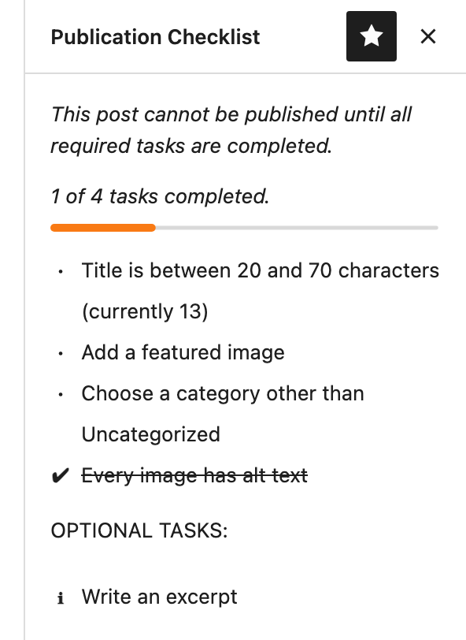
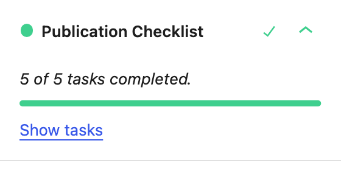
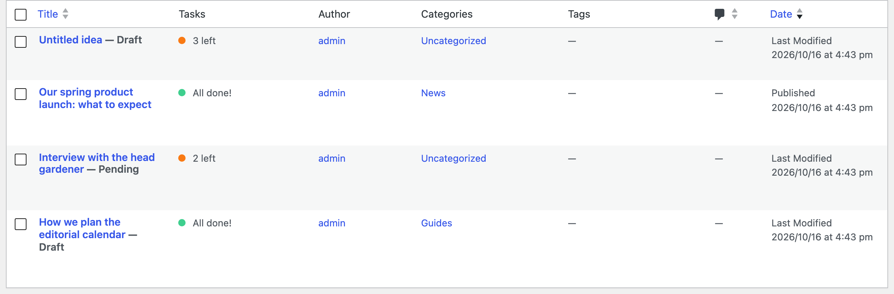

# Publication Checklist

Run checks and enforce conditions before posts are published. Built and designed for the WordPress block editor.

Publication Checklist provides a framework for building out prepublish checks, with flexibility to fit your workflows.


## Demo Plugin

If you prefer to get a boilerplate plugin to add checks and start playing with existing code directly you can download, install and activate the demo plugin available here:

https://github.com/humanmade/demo-publication-checklist


## Creating checks

The core of a check is a function that receives the post's data and meta, and returns a `Status` object. This status object indicates whether publish should be blocked or not.

For example, to enforce setting a value for the "foo" meta key:

```php
use function Altis\Workflow\PublicationChecklist\register_prepublish_check;
use Altis\Workflow\PublicationChecklist\Status;

add_action( 'altis.publication-checklist.register_prepublish_checks', function () {
	register_prepublish_check( 'foo', [
		'run_check' => function ( array $post, array $meta, array $terms ) : Status {
			if ( isset( $meta['foo'] ) ) {
				return new Status( Status::COMPLETE, 'Foo completed' );
			}

			return new Status( Status::INCOMPLETE, 'Missing foo data' );
		},
	] );
} );
```

Checks are registered via the `Altis\Workflow\PublicationChecklist\register_prepublish_check` function with a unique ID. This function should be called on the `altis.publication-checklist.register_prepublish_checks` action.

**Note:** the `altis.publication-checklist.register_prepublish_checks` action runs on the `plugins_loaded` hook so you should make sure your `add_action()` call is run as soon as your custom plugin file is included or in your theme `functions.php`. Do not wrap it in a hook such as `init` or `after_setup_theme`.

Your check function receives the post data as an array, and the post's meta data as an array. Your function should only use this data to run the check, as this may represent data before it is saved to the database. Specifically, your function's signature should be:

```php
function ( array $post, array $meta, array $terms ) : Status;
```

Your function must return an `Altis\Workflow\PublicationChecklist\Status` object. This object is marked as either complete (allow publishing), incomplete (block publishing), or informational (show as failed, but allow publishing). This status object takes the status type (which should be either `Status::COMPLETE`, `Status::INCOMPLETE`, or `Status::INFO`) and a human-readable message.

`$post` is an array of post data, matching the shape returned by `get_post( $id, ARRAY_A )`. `$meta` is an array of meta data, in the format `string $key => mixed|mixed[] $value`. `$terms` is an array of terms, in the format `string $taxonomy => int[] $terms`.

You can additionally pass data with the status object, which can be used on the frontend to assist with rendering.

By default, checks will only run against the `post` post type. You can pass the relevant type(s) as a `type` option:

```php
add_action( 'altis.publication-checklist.register_prepublish_checks', function () {
	// Pass a single type:
	register_prepublish_check( 'foo', [
		'type' => 'page',
		// ...
	] );

	// Or multiple:
	register_prepublish_check( 'foo', [
		'type' => [
			'post',
			'page',
		],
		// ...
	] );
```


## Live checks (PHP)

Existing checks update whenever the post is saved. To make a check re-evaluate
*live* as the user edits the post — without requiring a save — add `'live' => true`
to the check registration:

```php
register_prepublish_check( 'has-featured-image', [
    'type'      => 'post',
    'live'      => true,
    'fields'    => [ 'featured_media' ], // optional: only re-run when this field changes
    'run_check' => function ( array $post, array $meta, array $terms ) : Status {
        return ! empty( $post['featured_media'] )
            ? new Status( Status::COMPLETE, 'Featured image set' )
            : new Status( Status::INCOMPLETE, 'Add a featured image' );
    },
] );
```

The `fields` key is optional. If omitted, the check re-runs on every edit. If
provided, it accepts an array of:
- Post attributes (e.g. `'title'`, `'featured_media'`, `'status'`)
- Meta keys prefixed with `meta.` (e.g. `'meta.my_key'`)
- Taxonomy names prefixed with `terms.` (e.g. `'terms.category'`, `'terms.post_tag'`)

> **Note on `fields`:** This is a *client-side* optimisation hint. The browser
> skips the REST round-trip when none of a check's declared fields have changed,
> saving typing latency. Server-side, every matching live check still runs on
> every request regardless of what changed. Write expensive `run_check` callbacks
> defensively — they may be called on any edit.

> **Note:** The `run_check` callback receives the *unsaved* edited values, not the
> saved post. Check callbacks must be read-only — do not perform database writes
> based on the supplied data.

The PHP-side enforcement at publish time is unchanged: if a check returns
`Status::INCOMPLETE` when the post is saved, publication is still blocked.


## Live checks (JS)

For checks that depend on browser-only state, or when you prefer to keep the
check logic in JavaScript, use the JS registration API:

```js
// Via the global (no build step required):
const { registerPrepublishCheck, Status } = window.publicationChecklist;

// Or import it — add `altis_publication_checklist` as a webpack external mapped
// to `window.publicationChecklist` in your project's webpack config:
import { registerPrepublishCheck, Status } from '@humanmade/publication-checklist';

registerPrepublishCheck( 'has-featured-image', {
    type: 'post', // optional; matches PHP 'type' field
    runCheck: ( { post, meta, terms, select } ) => {
        const hasFeatured = !! select( 'core/editor' ).getEditedPostAttribute( 'featured_media' );
        return hasFeatured
            ? new Status( Status.COMPLETE, 'Featured image set' )
            : new Status( Status.INCOMPLETE, 'Add a featured image' );
    },
} );
```

- `runCheck` must be synchronous and return a `Status` instance (or a plain
  `{ status, message, data }` object).
- `post`, `meta`, and `terms` are pre-built from the current editor state so
  most checks won't need to call `select` directly. `terms` is keyed by taxonomy name, for example `terms.category` and `terms.post_tag`.
- If a JS check registers the same `id` as a PHP check, the JS verdict takes
  precedence in the pre-publish panel. The PHP check still enforces at publish time.
- JS-only checks (no PHP counterpart) are enforced client-side via the
  `lockPostSaving` mechanism — there is no server-side enforcement at publish time.
  If server-side enforcement matters, register a PHP `run_check` for the same id.


## Displaying check status

By default, Publication Checklist will render a simple checklist of all checks.

The REST API includes each post's check results in a `prepublish_checks` field. The field is only returned with `context=edit`, so only users who can edit the post can see it.

You can override a specific item to render richer UI if needed. For example, you may wish to integrate deeply into the block editor, or allow users to correct failing checks inline. This UI is directly inserted into the React element tree and replaces the default output.

Publication Checklist exposes a `altis-publishing-workflow.item.{check_id}` filter using [`withFilters`](https://github.com/WordPress/gutenberg/tree/master/packages/components/src/higher-order/with-filters) to allow overriding the list item component.

For example, to wrap the default status message with a link to a documentation page for the `foo` check:

```jsx
import { Fragment } from '@wordpress/element';

addFilter( 'altis-publishing-workflow.item.image-texts', 'foo/link-message', () => {
	return props => {
		return (
			<Fragment>
				{ props.renderStatusIcon() }
				<a href="http://example.com/">{ props.message }</a>
			</Fragment>
		);
	};
} );
```

Return the parts in a `Fragment`, as in the example, not inside one wrapping element. Each list item is a grid. The status icon and the message share the first line, and anything after the message goes on its own line under it. If you wrap everything in one element, it all stays on one line.

Your component receives the following props:

```jsx
const propTypes = {
	// Check ID.
	name: PropTypes.string.isRequired,

	// Human-readable message returned from the backend.
	message: PropTypes.string.isRequired,

	// Status string.
	status: PropTypes.oneOf( [ 'complete', 'incomplete', 'info' ] ).isRequired,

	// Function to render the status of the current check.
	// () => ReactElement
	renderStatusIcon: PropTypes.func.isRequired,

	// Additional data from the backend.
	data: PropTypes.any,
};
```

To enable advanced functionality, you may want to wrap this component in [selectors which provide data about the post](https://developer.wordpress.org/block-editor/data/data-core-block-editor/). By default, check status updates when the post is saved to the backend. To update the checklist in real time as the user edits, use live checks: see [Live checks (PHP)](#live-checks-php) and [Live checks (JS)](#live-checks-js).


## Enforcing checks

To enforce these checks and block publication, filter the `altis.publication-checklist.block_on_failing` value and return true from your callback. Editors can still save drafts. The Publish button in the pre-publish panel stays disabled, with a message that checks must be completed, until the required tasks are done. The server also rejects requests to publish the post while checks fail.

A blocked REST publish request returns a 400 error with the code `altis_publication_checklist_incomplete`, and lists the failing checks under `data.checks`.



## Showing the tasks expanded

Once every required task is complete, the pre-publish panel hides the task list behind a "Show tasks" button. To list the tasks by default, filter the `altis.publication-checklist.show_tasks_expanded` value and return true from your callback. Editors can still collapse the list with "Hide tasks".




## Modifying the list view

Publication Checklist will add a Tasks column to the Posts list screen showing the status of each post. This column is only shown if statuses have been registered.



### Hiding the tasks column

To hide this column, filter the `altis.publication-checklist.show_tasks_column` value and return false from your callback. This will hide the Tasks column.

### Changing the location of the tasks column

The tasks column appears after the title column by default on supported post types.

To change which column the tasks column appears after use the `altis.publication-checklist.show_tasks_after_column` filter and return the desired column slug such as `title`, `author` or `tags` for example.

## Local development

A WordPress Playground environment is included for local development and running the e2e test suite.

**Requirements:** Node.js 20+, npm.

```bash
# Install dependencies (first time only)
npm install
npx playwright install --with-deps chromium

# Build the plugin assets
npm run build          # one-off build
npm run start          # watch mode

# Start the Playground environment
npm run playground:start

# Run the e2e test suite
npm run test:e2e       # headless
npm run test:e2e:watch # Playwright UI (interactive)
npm run test:e2e:debug # pause on first failure
```

The Playground starts WordPress with the plugin pre-activated and a small test-fixture mu-plugin (`tests/fixtures/mu-plugin-live-checks.php`) that registers the checks used by the e2e suite. The JS counterpart (`tests/fixtures/live-checks.js`) is automatically enqueued by the mu-plugin.

## Release Process

Merges to `main` will automatically build to the `release` branch.

To cut a release, [run the Release workflow](https://github.com/humanmade/publication-checklist/actions/workflows/release.yml) with the version number, without a leading `v` (for example `1.2.3`). The workflow builds the plugin from `main`, replaces the `__VERSION__` placeholder in `plugin.php`, commits the built files, and pushes a new `v1.2.3` tag. It then publishes a GitHub release with a ZIP of the plugin. The workflow stops if the tag already exists, so a tag is never moved once it is published.

If a run fails after it has pushed the tag, run the workflow again with the same version. It reuses the tag that the earlier run made and only publishes the GitHub release. It still stops if the tag was made any other way.

To make a pre-release, add a suffix to the version, for example `1.2.3-beta1` or `1.2.3-RC1`. The workflow marks any version with a suffix as a pre-release. Packagist only reads Composer's stability suffixes: `alpha`, `beta`, `RC`, `patch` and `dev`, optionally followed by a number. It ignores a tag with any other suffix, such as `1.2.3-hotfix`, and that version can't be reused because tags are never moved.

Tagged releases can be installed via [packagist](https://packagist.org/packages/humanmade/publication-checklist) and [composer](http://getcomposer.org/). A project may also be set up to track the `dev-release` branch to use the latest built beta versions in between tagged releases.


## License

Publication Checklist is licensed under the GPLv2 or later. Copyright 2019 Human Made and contributors.
